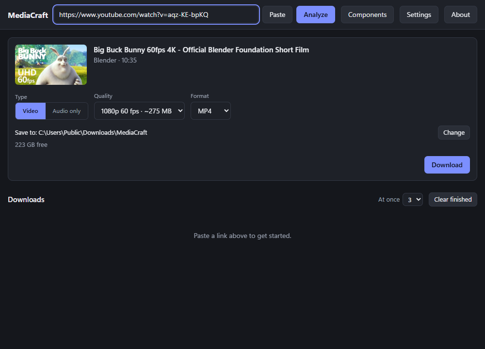
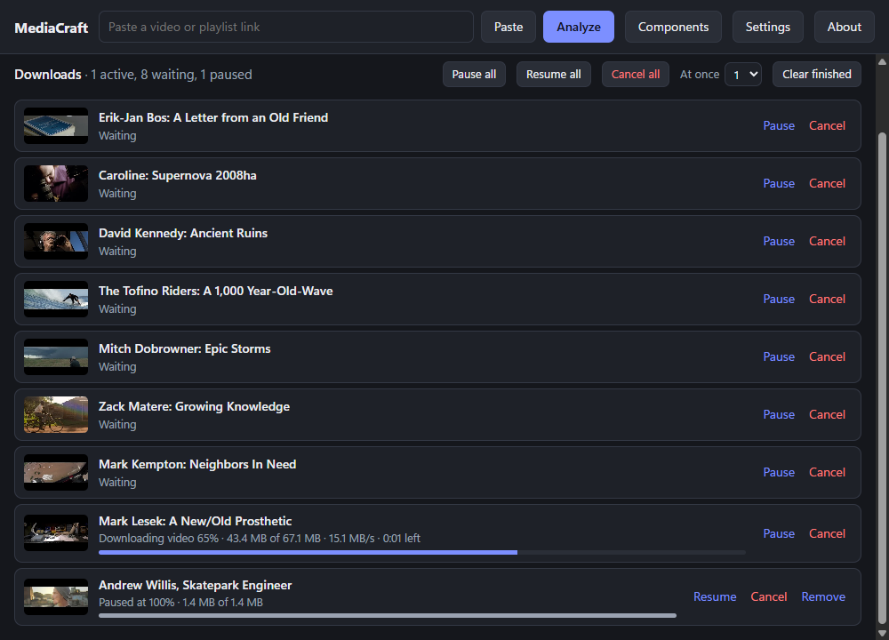

# MediaCraft

**A free, open source YouTube downloader for Windows.** Grab a single video or a whole playlist, pick the quality and format, or keep just the audio as MP3.

I wanted a downloader that was small, had no ads and didn't nag me to upgrade. Because we all love free, I decided to open source it.



## What it does

- **Single videos**, in any quality the video really offers, up to 4K, as MP4, MKV or WebM
- **Complete playlists**, where you tick the videos you want and can save them to a named folder with numbered files
- **Audio only**, as MP3, M4A, Opus, FLAC or WAV
- **Pause, resume and cancel**, for one download or all of them at once
- **Several downloads at once**, up to 8, with the rest waiting their turn
- **Picks up where it stopped**, even after you close the app

It also checks your save folder before starting, so a missing drive gets you a clear message instead of a mystery failure.



## Install

There's no ready-made installer yet, so for now you build it yourself. You'll need [Node.js](https://nodejs.org) and [Rust](https://rustup.rs) 1.87 or newer.

```bash
git clone https://github.com/ra7bi/MediaCraft.git
```

```bash
cd MediaCraft
```

```bash
npm install
```

```bash
npm run tauri build
```

The installer lands in `src-tauri/target/release/bundle/nsis/`. It's about 2 MB and doesn't need admin rights.

## The first time you open it

MediaCraft doesn't do the hard work alone. It uses [yt-dlp](https://github.com/yt-dlp/yt-dlp) to fetch videos, [FFmpeg](https://ffmpeg.org) to merge and convert them, and a JavaScript runtime such as [Deno](https://deno.com) for full YouTube support.

If those are already on your PC, it finds them. If not, open **Components** and install them with a click. They come from their official releases and are checked against the published checksums. On a PC with none of them, expect about 330 MB in total, most of it FFmpeg.

## What it doesn't do

- It only runs on Windows for now.
- It's only been tested with YouTube. yt-dlp supports many other sites, so others may work, but I make no promises.
- Videos that need you to sign in aren't supported.
- It won't download DRM-protected content.

Only download what you have the right to, and follow each site's terms. If the video isn't yours, that's between you and its owner.

## For developers

The app is built with Rust and [Tauri](https://tauri.app), with a plain TypeScript interface and no framework. Run it in development mode with:

```bash
npm run tauri dev
```

Unit tests need no network:

```bash
cargo test --lib --manifest-path src-tauri/Cargo.toml
```

Most of the logic is in `src-tauri/src/`. Start with `engine.rs` for the download queue and `args.rs` for how yt-dlp gets called. `tests/e2e.rs` runs real downloads and checks each file with ffprobe, and `scripts/gui_demo.mjs` drives the installed app. Both are described in their own comments.

Found a bug or have an idea? Please [open an issue](https://github.com/ra7bi/MediaCraft/issues). Customer support is one person in Oman, so be patient.

## License

MediaCraft is under the [MIT License](LICENSE). yt-dlp, FFmpeg and Deno are separate projects with their own licenses. They aren't bundled with MediaCraft, which only downloads them when you ask it to.
